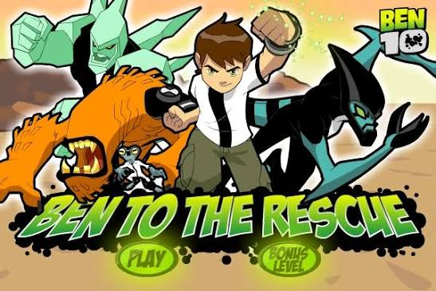
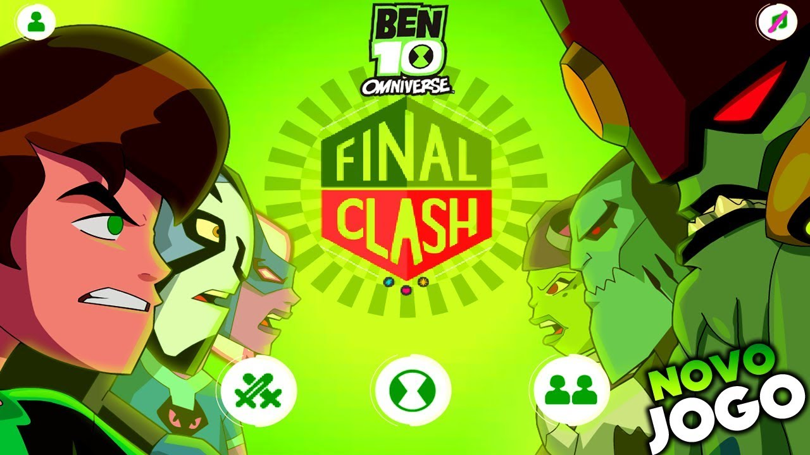
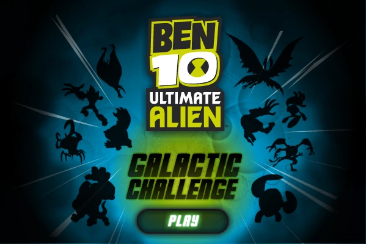
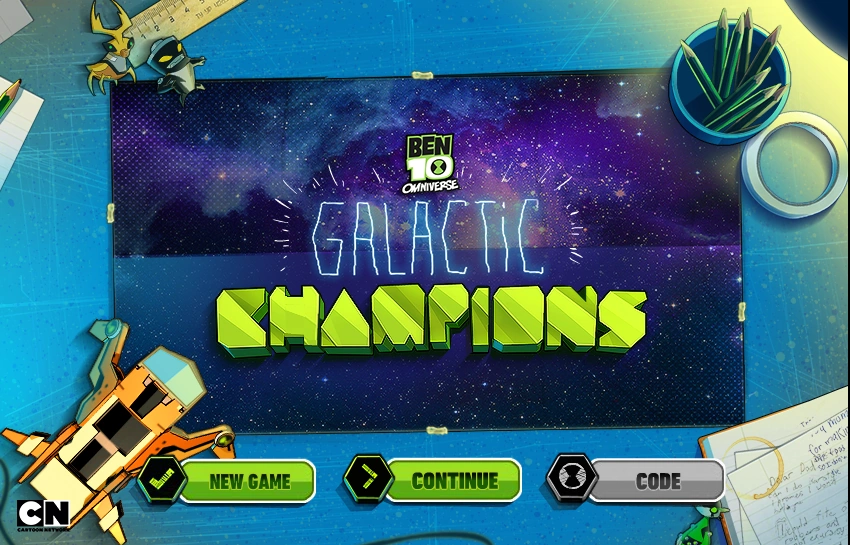
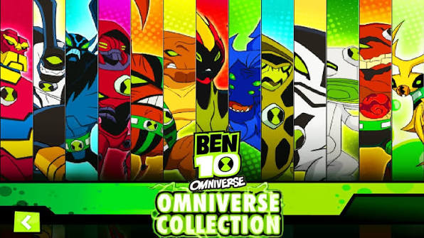
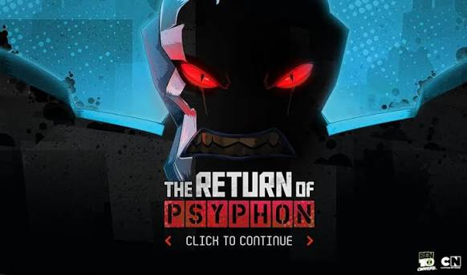

# Ben 10 Flash Games

Este repositório reúne jogos antigos do Ben 10 feitos em Flash. Para jogá-los, use o Ruffle, um programa que emula o Flash. O Ruffle para Windows está na pasta `ruffle-0.7.1-windows-x86_64`.

Este projeto é experimental e reúne apenas alguns jogos do Ben 10. Para explorar uma coleção muito maior de jogos em Flash, baixe o **Flashpoint Archive** pela [página oficial de downloads](https://flashpointarchive.org/downloads).

## Como abrir um jogo

1. Descompacte ou mantenha o repositório inteiro em uma pasta. Não separe os arquivos `.swf` dos demais arquivos do jogo: alguns precisam deles para carregar imagens, sons e fases.
2. Abra o PowerShell nessa pasta.
3. Execute o Ruffle com o caminho do arquivo `.swf` do jogo. Por exemplo:

   ```powershell
   .\ruffle-0.7.1-windows-x86_64\ruffle.exe ".\_Ben_10_Final_Clash.swf"
   ```

4. Para outro jogo, substitua o caminho do `.swf` pelo indicado abaixo. Também é possível arrastar o arquivo principal do jogo para o Ruffle.
5. Na tela inicial, siga as instruções do próprio jogo para começar e ver os controles. Os comandos variam entre os jogos; alguns usam as setas do teclado, outras teclas ou o mouse.

Se um jogo não abrir ou apresentar problemas, pode ser uma limitação de compatibilidade do Ruffle. Esta cópia do programa é a versão 0.7.1; uma versão mais recente do Ruffle pode funcionar melhor.

## Jogos

### Arquivos `.swf` na pasta principal

- **Ben 10 Gravity** — abra `Ben_10_Gravity.swf`. Jogo de ação e desafio com gravidade; avance pelas situações e obstáculos apresentados em cada fase.
- **Ben 10 Kraken Attack** — abra `Ben_10_Kraken_Attack.swf`. O desafio é enfrentar o Kraken e sobreviver ao ataque; use os comandos indicados na tela para agir.
- **Ben 10 Power Splash** — abra `Ben_10_Power_Splash.swf`. Jogo de ação com tema aquático; avance pelo percurso e supere os obstáculos usando os controles mostrados no início.
- **Ben 10 Vilgax Takedown** — abra `Ben_10_Vilgax_Takedown.swf`. Jogo de combate contra Vilgax; ataque e desvie dos golpes para vencer.

### Jogos em suas pastas

- **Ben 10 Ben to the Rescue** — abra `Ben 10 Ben to the rescue\Ben10_Ben_To_The_Rescue.swf`. A aventura é dividida em fases: avance, enfrente os desafios e ajude Ben a completar o resgate.

  

- **Ben 10 Final Clash** — abra `Ben 10 Final Clash\_Ben_10_Final_Clash.swf`. É um jogo de luta: escolha o modo e os personagens, depois use os comandos exibidos para atacar e se defender. Há opções para um ou dois jogadores.

  

- **Ben 10 Galactic Challenge** — abra `Ben 10 Galactic Challenge\_PLAY THE GAME.swf`. Encare desafios com os alienígenas do Ben; escolha as opções no menu e complete cada prova seguindo as instruções.

  

- **Ben 10 Galactic Champions** — abra `Ben 10 Galactic Champions\Ben_10_Galactic_Champions.swf`. Monte e prepare sua equipe de alienígenas e dispute um torneio, avançando pelas batalhas.

  

- **Ben 10 Omniverse Collection** — abra `Ben 10 Omniverse Collection\Ben_10_Omniverse_Collection.swf`. É uma coleção de jogos/desafios do universo Omniverse; escolha uma opção no menu e veja as instruções específicas de cada atividade.

  

- **Ben 10 The Return Of Psyphon** — abra `Ben 10 The Return Of Psyphon\Ben_10_The_Return_Of_Psyphon.swf`. Acompanhe Ben em uma aventura de ação por fases, enfrentando inimigos até chegar ao confronto com Psyphon.

  

Nos jogos dentro de pastas, abra o arquivo principal indicado e deixe os outros arquivos no mesmo lugar. Os demais `.swf` dessas pastas são, em geral, partes do jogo — como personagens, sons, menus ou fases — e não devem ser abertos separadamente.
